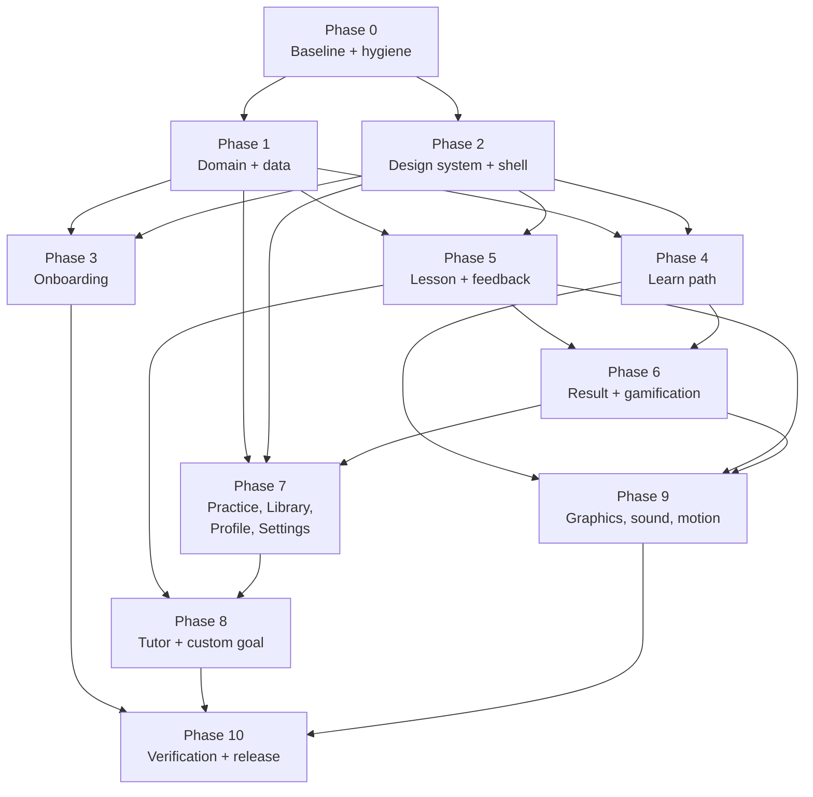

# 03 — Implementation plan

Prepared: 31 October 2026 (WAT) · Applies to `app/` (Flutter package `sumi`)
Inputs: `01-repository-assessment.md`, `02-requirements-matrix.md` (requirement IDs), `04-design-contract.md` (DC §).
Status: plan only. **No application code was changed while preparing this document.**

---

## 0. How this plan works

### 0.1 Execution rules

1. **Phases run in order.** A phase starts only after the previous phase's **gate** passes. Steps inside a phase may run in parallel unless a step lists a dependency.
2. **Every commit cites requirement IDs**, for example `feat(lesson): incorrect CONTINUE + requeue [LES-05][CF-05]`.
3. **Tests change only on purpose.** When a test asserts copy or behaviour that the matrix changes, update it in the same commit and list it in that commit's message. §13 lists the known cases.
4. **Use the existing seams. Do not rewrite them.** These stay and are extended:
   - `LocalStore.transaction`;
   - `LearningSessionController`;
   - `ChallengeRendererRegistry`;
   - `LearningPathController` event claiming;
   - `SessionResult`;
   - `TutorOrchestrator` and `PhoneModelController`.

   (Assessment §9.)
5. **Preserve learner data.** Every schema change ships with a migration and a fixture test (ARC-03). A migration never deletes the previous key until the new write has succeeded.
6. **CRLF.** `main.dart` uses CRLF line endings. Preserve them in any file that already has them.
7. **Commands** (Windows, from the repo root):
   - Analyze: `.\scripts\flutter.ps1 analyze`
   - UI tests: `.\scripts\test-ui.ps1` (pass paths or flags through, for example `.\scripts\test-ui.ps1 test/goldens --update-goldens`)
   - Phone suite: `.\scripts\test-phone.ps1 -Device <id>`
   - Debug APK: `.\scripts\flutter.ps1 build apk --debug --target-platform android-arm64,android-x64`

### 0.2 Global Definition of DONE

These apply to every requirement. Each phase adds its own DONE list on top.

A requirement is **DONE** only when all of the following are true:

1. **Behaviour.** The acceptance criteria on its matrix card pass.
2. **Tests.** Its verification test exists, runs in `test-ui.ps1`, and passes. Bugs get a regression test first.
3. **Visual.** For UI work, the goldens at 390 × 844 and 320 × 700 match DC values. Text at 2.0× has no overflow. Reduced motion reaches the same final state.
4. **Tokens.** No colour, duration, radius or text-style literals were added outside `lib/design_system/` and `theme.dart`.
5. **Accessibility.** Semantics labels are present, targets are ≥ 48 × 48, and state uses icon + text + colour. `meetsGuideline` checks pass for the touched screens.
6. **Truth.** No copy claims a capability the code lacks (QA-03 passes).
7. **Persistence.** Any new mutation goes through a use case and a transaction, and has a fault-injection test.
8. **Analyzer.** `flutter analyze` reports zero issues.
9. **Assets.** Any new asset is recorded in `app/assets/ASSETS.md`.
10. **Docs.** The matrix row's "Current state" is updated to **Done**, with the test file name.

### 0.3 Phase overview

Once Phases 1 and 2 pass, Phases 3, 4 and 5 can run in parallel in separate branches. They touch different files, except `main.dart`, so extract from `main.dart` first (step 2.7).

---

## 1. Phase 0 — Baseline and hygiene

**Goal:** a compiling, green, legally clean starting point.
**Requirements:** GOV-01, GOV-02, GOV-04 (register skeleton), GOV-05.
**Entry:** none.

| # | Step | Files | Notes |
|---|---|---|---|
| 0.1 | Run the analyzer and the UI tests on today's uncompiled changes. Save the logs. | `.tooling/phase0-analyze.log`, `.tooling/phase0-test.log` | Assessment §11.1 |
| 0.2 | Fix analyzer errors in the S7 §8 files. | `lib/learning_path/path_screen.dart`, `learning_path_controller.dart`, `session_result/session_result_screen.dart`, `learning_session/feedback_panel.dart`, `main.dart`, `mascot/*`, `motion/celebration.dart` | No behaviour change |
| 0.3 | Fix the test-harness bug "a painting debug variable was changed by the test". | `test/session_recording_test.dart` | Reset `debugPaint*` flags in `tearDown` |
| 0.4 | Re-check the `Key ideas` failure. Fix it, or confirm it is stale. | `test/correction_spec_test.dart` | |
| 0.5 | Extend `.gitignore` with every path in GOV-01. Add `research/THIRD_PARTY_EXCLUDED.md`. | `.gitignore` | Owner decision E-01: default is to exclude everything listed |
| 0.6 | Add a hygiene check that fails if tracked files include APKs, `.riv` files, Lottie JSON, captures or Duolingo-named files. | `scripts/check_repo_hygiene.ps1` | |
| 0.7 | Make the Duolingo slot labels in `SumiAnim` debug-only. Show the mascot gallery in debug builds only. | `lib/mascot/sumi_rig.dart`, `main.dart` (Settings row) | GOV-05 |
| 0.8 | Create the `app/assets/ASSETS.md` skeleton and list the current assets: the JSON files, sounds and painters. | `app/assets/ASSETS.md` | GOV-04 |

**Tests:** existing suite; new `test/content_lint_test.dart` (the GOV-05 part of QA-03).

**Gate G0:**

- [ ] Analyzer: 0 issues.
- [ ] Test suite: 100 % pass; the count is recorded.
- [ ] `git status --ignored` shows every GOV-01 path as ignored; `git ls-files` shows none of them.
- [ ] The hygiene script exits with 0.
- [ ] The content lint finds no `DUO_` or "Duolingo" in non-debug strings.

**DONE (Phase 0):** G0 passes, and the first commit (local only, not pushed) contains only clean files. **Nothing is pushed to GitHub before G0.**

---

## 2. Phase 1 — Domain and data foundation

**Goal:** honest, transactional, data-driven learning state. Fix the domain defects before any visual work (S3 Prompt 1, S4 §12).
**Requirements:** ARC-01, ARC-02, ARC-03, ARC-04, ARC-05, ARC-07, GAM-01 (policy), GAM-02, LES-11 (rule), LES-15 (content), EVD-01, EVD-02, LIB-04, QA-03.
**Entry:** G0.

| # | Step | Files (create / modify) | Depends on |
|---|---|---|---|
| 1.1 | Write v3 fixtures: fresh, mid-onboarding at step 3, and completed with progress (anonymised from a device export). | `test/fixtures/v3_*.json` | — |
| 1.2 | Add the schema v4 models: `LearnerSettings` (sound, haptics, reducedMotion, highContrast, textMode, aiMode, cloudConsent, explanationLength); nullable onboarding answers; ledger `RewardTransaction{sourceId, rewardType}`; per-challenge first-attempt map; `reviewDueAt`; quest state; `recoveryTokens`. | `lib/models.dart` | 1.1 |
| 1.3 | Add the `fromV3` migration and the v4 key. Keep the v3 key. Move consent out of `constraints`. Clear default answers when onboarding is incomplete and at step ≤ 3. Back-fill the ledger without recomputing points. | `lib/models.dart`, `lib/services.dart` | 1.2 |
| 1.4 | Add the use-case layer: `SaveOnboardingAnswer`, `FinishOnboarding`, `SelectDiscipline`, `RecordAttempt`, `CompleteActivity`, `RecordResourceUse`, `QualifyDailyGoal`, `GetNextLearningSession`, `UpdateSetting`, `AskTutor`. Each wraps exactly one `LocalStore.transaction`. | `lib/application/use_cases.dart` (new) | 1.3 |
| 1.5 | Route every direct mutation through use cases. Delete `LearningHome.persist()` as a mutation path. Add a debug-mode guard on writes outside a transaction. | `main.dart`, `lib/services.dart`, `lib/assessment.dart`, `lib/resource_detail_screen.dart` | 1.4 |
| 1.6 | Add the points policy (S1 §11.1 and CF-09) and the stable source IDs. Make `pointsTotal` and `pointsWeek` derived from the ledger. | `lib/engagement/points_policy.dart` (new), `lib/models.dart`, `lib/learning_session/learning_session_controller.dart` | 1.2 |
| 1.7 | Change the Focus rule to "first persisted incorrect attempt per challenge only". Stop mirroring Focus into lifetime engagement. | `learning_session_controller.dart` | — |
| 1.8 | Fix evidence promotion. `demonstrated` maps to `independent` only. `transferred` requires a `context: transfer` challenge or an assessed project rubric. | `lib/models.dart`, `learning_session_controller.dart` | 1.9 |
| 1.9 | Extend the content schema: `units[]`, `skills[].type`, `unit_id`, `challenges[]` (with `parallel_of`, `hint`, `context`, `rubric`), `preview_capabilities[3]`, `evidence_categories`, `celebration`, `scene`. Add a `video_resource`, a `checkpoint` and a `reward_unlock` node per unit. | `scripts/build_disciplines.py`, `assets/disciplines.json`, `lib/models.dart` (`Milestone`, `Catalog`) | — |
| 1.10 | Author per-node challenges for Music and Fashion: 4–6 per node, ≥ 2 kinds each, parallel variants, ≥ 1 near-correct-capable item per unit, checkpoint items with new examples. Record the source and AI-assistance note in the README. | `scripts/build_disciplines.py` (content source) | 1.9 |
| 1.11 | Make `challengesFor` a pure loader with the legacy fallback. Move discipline evidence categories and celebration type into data. | `lib/learning_session/challenge_definition.dart`, `lib/session_result/session_result_assembler.dart` | 1.9 |
| 1.12 | `LearningUnit.forCatalog` reads `units[]` from data, falling back to groups of three. | `lib/learning_path/learning_path_state.dart` | 1.9 |
| 1.13 | Extend the content lint: coding residue, banned learner labels, `example.com`, banned settings copy (DC §11.7). | `test/content_lint_test.dart` | 1.10 |

**Integration points:**

- `LearningHome` (composition root) builds the use cases and passes them to the tabs.
- `LearningSessionController.advance()` calls `CompleteActivity` inside its existing transaction mutation callback, so atomicity is kept.
- The `pathEvents` contract is unchanged.

**Tests, new:**

| File | What it covers |
|---|---|
| `test/migration_v4_test.dart` | The 3 fixtures: v3 key still present; identical totals |
| `test/transaction_guard_test.dart` | A store that throws on write → in-memory state unchanged for onboarding, resource save, attempt and completion |
| `test/points_policy_test.dart` | Table-driven: all S1 §11.1 rows, the perfect bonus, review/project substitution, checkpoint |
| `test/invariants_test.dart` | The six S2 §5 invariants over random action sequences (seeded) |
| `test/content_schema_test.dart` | Unique IDs, acyclic prerequisites, every challenge valid and gradeable, every video node resolves, all seven node types present per track, no two nodes share an identical challenge list |
| `test/evidence_promotion_test.dart` | Hint ≠ independent; ordinary completion ≠ transferred; near-correct revision = supported |
| `test/focus_rule_test.dart` | Decrements only on the first incorrect attempt; reaching 0 does not lock |

**Tests, extended:** `session_contract_test.dart` (completing two lessons within a minute awards both; replay awards nothing; persistence failure stays consistent); `evidence_test.dart`; `resource_system_test.dart` (a view grants no evidence or streak).

**Gate G1:**

- [ ] All new and extended tests pass; the analyzer is clean.
- [ ] Every v3 fixture migrates with byte-identical totals for points, streak, completed nodes and evidence.
- [ ] `grep -R "store.save(" lib/` finds matches only inside `LocalStore`.
- [ ] `grep -R "'music'\|'fashion'" lib/` finds no matches outside fixtures.
- [ ] Each track exposes 7 node types; no shared challenge lists.
- [ ] The S3 P1 required-test list passes: items 1–5, 7–10 and 13. Items 6, 11 and 12 belong to Phases 7, 1 (lint) and 2.

**DONE (Phase 1):** G1 passes. A scripted run on the phone suite completes one Music lesson and one Fashion lesson end to end with correct points, Focus and evidence.

---

## 3. Phase 2 — Design system and shell

**Goal:** the tactile primitives and tokens every later screen uses.
**Requirements:** TYP-01, MOT-01, MOT-03, MOT-04, LES-13, SHL-01–05, A11Y-01 (primitives; enforced in every later phase through DONE item 5), A11Y-02, A11Y-06, A11Y-07; the DC §2–§7 primitives.
**Entry:** G0. This phase can run alongside Phase 1, but step 2.7 waits for 1.5.

| # | Step | Files | Notes |
|---|---|---|---|
| 2.1 | Bundle Nunito 500–900 plus `OFL.txt`. Register the fonts in `pubspec.yaml`. Load the font in the test bootstrap so goldens are stable. | `assets/fonts/*`, `pubspec.yaml`, `test/flutter_test_config.dart` (new) | CF-26 |
| 2.2 | Tokens: add the DC §2.2 tokens, the high-contrast palette (DC §2.4), `SumiType` (DC §3.2), `SumiSpace`, `SumiRadius`, `SumiDepth`, and `SumiLayout.gutter`. `sumiTheme({highContrast})`. | `lib/theme.dart`, `lib/design_system/layout.dart` (new) | |
| 2.3 | Motion: `SumiMotion` tokens (DC §6.1), the `reduceMotion(context)` helper, and the `loopsEnabled` flag (false under `FLUTTER_TEST`). | `lib/design_system/motion.dart` (new) | MOT-01, MOT-04 |
| 2.4 | Components: `TactileButton` (all variants and states, DC §7.1), `ChoiceRow` (DC §7.2), `SumiProgressBar` (DC §7.3), `Tag` and `Pill` (DC §7.4), `SumiCard` (DC §7.5), `SumiTextField` (DC §7.6), `SumiChip` (DC §7.7), sheet, popover and scrim helpers (DC §7.9), `EmptyState` (DC §7.34), `Skeleton` (DC §7.35), `InlineError` (DC §7.36). | `lib/design_system/*.dart` (new) | Replace `ActionButton`, `Surface` and `Tag` in `widgets.dart` with re-exports |
| 2.5 | `SumiBottomNav` (DC §7.10). Replace the Material `NavigationBar`. | `lib/design_system/bottom_nav.dart`, `main.dart` | SHL-02 |
| 2.6 | Shell: gutters via `SumiLayout`; the boot and recovery screens (DC §8.1); confirm the `IndexedStack` path never renders an empty body; pointer-up → first-paint timing in debug builds. | `main.dart`, `lib/shell/recovery_screen.dart` (new) | SHL-03, SHL-05 |
| 2.7 | Extract from `main.dart`: `onboarding/onboarding_flow.dart`, `tabs/practice_tab.dart`, `tabs/library_tab.dart`, `tabs/profile_tab.dart`, `settings/settings_screen.dart`. A move-only commit. | `main.dart` → new files | Waits for 1.5. No behaviour change; CRLF preserved in the files that keep it |

**Tests:**

| File | What it covers |
|---|---|
| `test/goldens/components_test.dart` | Every component × every state, at 1.0× and 2.0×, default and high contrast |
| `test/tab_retention_test.dart` | Slow fake repository: no empty body; five rapid switches; scroll preserved |
| `test/a11y_primitives_test.dart` | `androidTapTargetGuideline`, `labeledTapTargetGuideline`, `textContrastGuideline` (high-contrast theme) |
| `test/motion_guard_test.dart` | With `loopsEnabled = false`, `pumpAndSettle` completes on every screen that has a loop |

**Gate G2:**

- [ ] Component goldens approved against DC §7.1–7.10 (side-by-side review sheet in `docs/implementation/review/phase2.png`).
- [ ] TactileButton pressed state: 3 px translation and the edge 4 → 1, measured in a golden at mid-press.
- [ ] No `'Arial'` remains; tabular figures confirmed in a counter golden.
- [ ] The tab-retention test passes. The existing suite is still green after the extraction.
- [ ] The high-contrast theme passes `textContrastGuideline` on the component sheet.

**DONE (Phase 2):** G2 passes, and later phases can build screens from primitives without adding new literals.

---

## 4. Phase 3 — Onboarding

**Goal:** the S1 §9.1–9.10 flow, exact.
**Requirements:** ONB-01 to ONB-12, CUS-01 (the honest custom branch).
**Entry:** G1 and G2.

| # | Step | Files |
|---|---|---|
| 3.1 | `OnboardingScaffold` (DC §8.2): back button, 10 px progress bar, sticky CONTINUE, the `screen` slide transition, and Android back handling. | `lib/onboarding/onboarding_scaffold.dart` |
| 3.2 | Per-step validity with no defaults (CF-18). `SaveOnboardingAnswer` on every valid change. | `lib/onboarding/onboarding_flow.dart` |
| 3.3 | Promise screen (ONB-01), with the interim hero until Phase 9. | `lib/onboarding/steps/promise_step.dart` |
| 3.4 | Discipline grid with `DisciplineCard` (DC §7.27); select, then Continue; the custom sheet; `SelectDiscipline` keyed to the selected catalogue (ONB-12). | `lib/onboarding/steps/discipline_step.dart`, `lib/design_system/discipline_card.dart` |
| 3.5 | Outcome (20–200 characters, chips, deadline including Custom date, constraints, keyboard insets). | `steps/outcome_step.dart` |
| 3.6 | Motivation, with its support line; level; outcome preview from `preview_capabilities`; daily goal, with labels and the workload estimator. | `steps/*.dart`, `lib/onboarding/workload_estimator.dart` |
| 3.7 | Starting route and branching: Basics skips the baseline and flags three CHECK challenges for the first lesson; Find my level runs the baseline. | `steps/route_step.dart`, `lib/application/use_cases.dart` (`GetNextLearningSession`) |
| 3.8 | Re-skin the baseline to the lesson-shell components (it waits for 5.1–5.4 primitives; the interim keeps the current UI). | `lib/assessment.dart` |
| 3.9 | Route reveal (ONB-10): fix the step-8 completion skip; add the mini path preview, evidence count, confidence tag and "Why this route?"; `FinishOnboarding` in one transaction; START FIRST LESSON opens lesson 1. | `steps/route_reveal_step.dart` |
| 3.10 | Custom branch: create a unique `Goal`, then show the CUS-01 screen (DC §8.16). No fake content. | `lib/custom/custom_goal_screen.dart` |

**Tests:**

| File | What it covers |
|---|---|
| `test/onboarding_flow_test.dart` | Continue disabled on every step until valid; back and resume preserve each selection; a kill-and-restore at each step; fresh install → route reveal → lesson 1 |
| `test/onboarding_routes_test.dart` | Basics and Find my level produce different first sessions |
| `test/discipline_flow_test.dart` (extended) | Selecting Fashion runs Fashion's baseline; isolation between tracks |
| `test/custom_goal_test.dart` | Two custom goals → distinct IDs and isolated records; no `example.com`; `trackId` equals the active track |
| `test/goldens/onboarding_test.dart` | Every step at the four viewports, at 2.0×, and in high contrast |

**Gate G3:**

- [ ] The copy matches DC §11.1 exactly; a string-table test compares the rendered text.
- [ ] A clean install reaches the first lesson in ≤ 10 taps on the Find-my-level path (manual).
- [ ] The route reveal is always shown.
- [ ] S1 §19 tests 1, 2, 3 and 4 pass.

**DONE (Phase 3):** G3 passes, and the manual S1 §20 steps 1–5 succeed on the phone.

---

## 5. Phase 4 — Learn path

**Goal:** the S5 path system with Sumi semantics.
**Requirements:** PTH-01 to PTH-12, PTH-14; TUT-01 (removing the path tutor icon).
**Entry:** G1 and G2.

| # | Step | Files |
|---|---|---|
| 4.1 | `GoalCourseStrip` plus the rounded path surface (DC §7.11). Remove the path AppBar and its tutor icon. | `lib/learning_path/goal_course_strip.dart`, `path_screen.dart` |
| 4.2 | `PathStatusRow` (DC §7.13) and the points popover (DC §7.26). | `lib/learning_path/path_status_row.dart` |
| 4.3 | `UnitHeaderCard` with unit tokens, the depth edge and two tap zones (DC §7.14). | `lib/learning_path/unit_header.dart` |
| 4.4 | `PathNode` matrix (DC §7.12): semantic fills, locked with no edge, pressed, focus and hover. Keep the existing event-animation code (PTH-06). | `lib/learning_path/path_node.dart` (moved out of `path_screen.dart`) |
| 4.5 | Serpentine order (0, −A, 0, +A) and `PathConnectorPainter` (DC §7.16). | `lib/learning_path/serpentine_path.dart`, `path_connector_painter.dart` |
| 4.6 | START bubble plus the guarded breathing ring (PTH-07). | `path_node.dart` |
| 4.7 | `NodeActionCard` re-skin (DC §7.15): content-fit height, the white inset button with the base reward, the locked variant with GO TO {PREREQUISITE}, and Esc and scroll dismissal. | `lib/learning_path/node_action_card.dart` |
| 4.8 | `SectionOverviewSheet` (full-height sheet, DC §8.4) with CONTINUE and JUMP HERE → checkpoint. | `lib/learning_path/section_overview_sheet.dart` |
| 4.9 | Unit guide re-skin with the slide transition and `units[].guide` content (DC §8.5). | `lib/unit_guide_screen.dart` |
| 4.10 | `CheckpointDetailScreen` (DC §8.6). | `lib/learning_path/checkpoint_detail_screen.dart` |
| 4.11 | One auto-scroll per app session to the current node when it is outside the middle 60 % of the viewport. | `learning_path_controller.dart` |
| 4.12 | Add the `slide` page-route helper used by the guide, checkpoint, explain and streak screens. | `lib/design_system/routes.dart` |

**Tests:**

| File | What it covers |
|---|---|
| `test/path_card_test.dart` | A tap shows the card within 250 ms (fake clock); another tap replaces it, never stacks; outside tap, scroll and Esc dismiss; locked nodes name the prerequisite; never a bottom sheet |
| `test/path_events_test.dart` | Unlock and complete fire once, after persistence; never on rebuild |
| `test/path_scroll_test.dart` | Exact offset after a lesson, guide, settings or background round trip; one auto-scroll |
| `test/goldens/path_nodes_matrix_test.dart` | 7 types × 7 states, plus a greyscale variant |
| `test/goldens/learn_tab_test.dart` | The four viewports, 2.0×, high contrast; the first viewport contains the strip, status row, header, current node and one more node |

**Updated tests:** any test that finds the "Sections & units" title (it becomes a semantics label), "START STEP" (now "START +N POINTS"), or the path AppBar tutor icon. See §13.

**Gate G4:**

- [ ] S4 §10 path criteria and S5 §12 path criteria pass.
- [ ] The S6 release blocker "vertical stack of identical unlabelled circles" is visibly resolved (golden review).
- [ ] Switching discipline via the strip restores each track's scroll offset.

**DONE (Phase 4):** G4 passes, and S2 P1.1's acceptance check holds: the learner can tell "what am I doing now, what will I learn, what comes next" from the path alone, verified with two people who don't know the app.

---

## 6. Phase 5 — Lesson and feedback

**Goal:** the one-challenge cadence with the four feedback states.
**Requirements:** LES-01 to LES-21, A11Y-03, A11Y-05; ONB-09 (re-skin finish).
**Entry:** G1 and G2.

| # | Step | Files |
|---|---|---|
| 5.1 | `LessonProgressHeader` (DC §7.22) with the Focus pill and PRACTICE MODE. | `lib/learning_session/lesson_progress_header.dart` |
| 5.2 | `StickyLessonAction` (DC §7.23) with the skip and can't-do actions. Remove the always-visible 218 px panel. | `lib/learning_session/sticky_lesson_action.dart`, `feedback_panel.dart` |
| 5.3 | `FeedbackPanel` variants (DC §7.21): correct, incorrect, nearCorrect, retry, saveError. Exact copy; the points chip; the calibration row; the mascot slot (DC §7.33); live-region announcement. | `feedback_panel.dart` |
| 5.4 | Controller: incorrect → `canContinue`; a requeue list using `parallel_of`; progress counts only the original challenges; near-correct allows one revision, then Continue; rubric results on `Grade`. | `learning_session_controller.dart`, `learning_session_state.dart`, `challenge_definition.dart` |
| 5.5 | Renderer re-skin to `ChoiceRow` and the token bank (DC §7.2, §7.17–7.20); literal `feedbackColor` values become tokens; incorrect nudge and correct particles per MOT-02. | `challenge_renderer_registry.dart` |
| 5.6 | Hints and "I don't know yet" in lessons wherever the data has them. | Renderers, controller |
| 5.7 | Project-node structured reflection (DC §7.29) and the SAVE EVIDENCE CTA. | New kind `projectReflection` in `challenge_definition.dart` and the registry |
| 5.8 | `ExplainMistakeScreen` (DC §7.24), using the slide route. AI rephrase hooks are stubbed behind TUT-02 until Phase 8. | `lib/learning_session/explain_mistake_screen.dart`, `lesson_shell.dart` |
| 5.9 | `LessonSettingsSheet` and `ExitConfirmSheet` (DC §7.25). | `lib/learning_session/lesson_settings_sheet.dart`, `exit_confirm_sheet.dart` |
| 5.10 | `LessonLoadingScreen`, shown only after 150 ms. | `lib/learning_session/lesson_loading_screen.dart`, `main.dart` (`openMilestone`) |
| 5.11 | Re-entering a completed node shows the compact review; PRACTISE AGAIN starts a new session with no completion bonus. | `main.dart`, `learning_session_controller.dart` |
| 5.12 | Finish the baseline re-skin (step 3.8). | `lib/assessment.dart` |

**Tests:**

| File | What it covers |
|---|---|
| `test/lesson_feedback_test.dart` | Each variant's heading, copy and actions; announcement once; colour + icon + text |
| `test/lesson_requeue_test.dart` | Incorrect → CONTINUE → the variant appears before the end; progress math; near-correct revision once |
| `test/lesson_viewport_test.dart` | For every authored challenge, the prompt and response are fully visible at 390 × 844, 1.0×; reachable at 2.0× |
| `test/explain_settings_roundtrip_test.dart` | The draft and grade are unchanged after Explain or Settings |
| `test/goldens/renderers_test.dart` | 8 renderers × 8 states |
| `test/goldens/lesson_test.dart` | Neutral, correct, incorrect, near-correct, retry, save error; four viewports |

**Gate G5:**

- [ ] S4 §10 lesson criteria pass.
- [ ] S6's required lesson demonstration (video + application, ordering or matching, choice, reflection, correct, incorrect with Explain, near-correct, completion) runs for **both** Music and Fashion in widget tests.
- [ ] S6 release blockers "long article lesson" and "missing/generic feedback panel" are resolved.
- [ ] S1 §19: first attempt can't be overwritten; hint ≠ independent; feedback semantics; requeue; Focus at zero.

**DONE (Phase 5):** G5 passes, and the S1 §20 steps 6–7 succeed on the phone.

---

## 7. Phase 6 — Result and gamification

**Requirements:** RES-01 to RES-04, GAM-01 (UI), GAM-03, GAM-04, GAM-05, GAM-06 (GAM-07 optional).
**Entry:** G4 and G5.

| # | Step | Files |
|---|---|---|
| 6.1 | Result screen: retime to ≤ 1,200 ms, skippable; add the "Today" row (goal ring, streak, +1 DAY) and the Next card; primary CONTINUE, plus RETURN TO PATH and Review saved responses (DC §8.9). | `lib/session_result/session_result_screen.dart` |
| 6.2 | `AccoladeResolver` rules (RES-02). | `lib/session_result/accolade_resolver.dart` |
| 6.3 | `CheckpointFailScreen`, with the repair schedule hook. | `lib/session_result/checkpoint_fail_screen.dart` |
| 6.4 | CONTINUE → path → events → open the next node's card (`openCardAfterEvents`). | `lesson_shell.dart`, `path_screen.dart`, `learning_path_controller.dart` |
| 6.5 | Streak recovery tokens and qualifying-event records; injected clock. | `lib/engagement/streak_service.dart`, `models.dart` |
| 6.6 | Daily quests (derived from events), `QuestCard` (DC §7.28) and the chest. | `lib/engagement/quests.dart`, `quest_card.dart` |
| 6.7 | Streak screen (DC §8.15). | `lib/engagement/streak_screen.dart` |
| 6.8 | Sparks spending on cosmetics and tokens only. | `lib/engagement/sparks.dart` |

**Tests:** `test/result_screen_test.dart`; `test/streak_test.dart` (crossing midnight, a missed day with and without a token, never from app open, resource view or model download); `test/quests_test.dart`; `test/goldens/result_test.dart`.

**Gate G6:**

- [ ] Rewards are idempotent across kill and reopen (a phone-suite test).
- [ ] Streaks use local dates.
- [ ] No mechanic blocks learning: there is a test that a learner with 0 Focus, 0 sparks and no quests can complete a lesson.
- [ ] GAM-08: a widget-tree test finds no leaderboard, league or friend widgets.
- [ ] S2 P1.3: after completion, Learn and Profile show the same totals without a restart.

**DONE (Phase 6):** G6 passes, and the S1 §20 step 8 succeeds.

---

## 8. Phase 7 — Practice, Library, Profile and Settings

**Requirements:** EVD-03, EVD-04, PRA-01, PRA-02, LIB-01–04, PRO-01, PRO-02, SET-01–07, AIM-01 (re-skin only), A11Y-04.
**Entry:** G6.

| # | Step | Files |
|---|---|---|
| 7.1 | `ReviewScheduler` (S1 §12.4) with due reasons; retire `recallDone()`; feed `needsReview` and `recall_review`. | `lib/review/review_scheduler.dart`, `models.dart`, `learning_path_controller.dart` |
| 7.2 | Practice tab (DC §8.11): the five sections and the empty state. Reuse `PracticeScreen` if it fits, otherwise delete it with `two_day_review.dart` after confirming no references remain. | `lib/tabs/practice_tab.dart`, `lib/practice.dart` |
| 7.3 | Library (DC §8.13): groups, filter chips, `ResourceCard` (DC §7.31), detail-sheet re-skin, return-safe state, events through the use case. | `lib/tabs/library_tab.dart`, `resource_detail_screen.dart` |
| 7.4 | Profile (DC §8.12) and `EvidenceDetailScreen` (EVD-04) with event IDs and removal of self-reported evidence. | `lib/tabs/profile_tab.dart`, `lib/profile/evidence_detail_screen.dart`, `adaptation_screen.dart` (re-skin) |
| 7.5 | Settings: section order, the truthful subtitles from DC §11.5, the reminder toggle disabled with honest copy (plus the migration that clears a stale `remindersEnabled`). | `lib/settings/settings_screen.dart` |
| 7.6 | Accessibility settings screen: text mode, high contrast (live theme swap), reduced motion, sound, haptics, captions, verbosity. | `lib/settings/accessibility_settings_screen.dart`, `main.dart` (theme from settings) |
| 7.7 | Storage and privacy: summary, export and import JSON (`file_selector`), clear one or all with scoped confirmations; models stay separate. | `lib/settings/storage_privacy_screen.dart`, `services.dart` |
| 7.8 | About: `package_info_plus`, `showLicensePage`, model and content acknowledgements, AI-assistance disclosure. | `lib/settings/about_screen.dart`, `pubspec.yaml` |
| 7.9 | Re-skin the model cards to tokens (no logic change). | `lib/phone_models_screen.dart` |

**Tests:** `test/review_scheduler_test.dart`; `test/practice_tab_test.dart`; `test/library_roundtrip_test.dart`; `test/profile_evidence_test.dart` (every claim maps to event IDs); `test/settings_truth_test.dart` (each subtitle against state, before and after toggling); `test/export_import_test.dart`; and in `phone_models` tests, "remove model preserves progress; clear progress preserves models".

**Gate G7:**

- [ ] S2 P0.2: every Settings status is traceable to state.
- [ ] S3 P5 tests for Practice, Profile and Settings pass.
- [ ] Every essential flow is operable at 2.0× text (a golden plus a manual pass).

**DONE (Phase 7):** G7 passes, and S1 §20 steps 9, 13 and 14 succeed.

---

## 9. Phase 8 — Tutor and custom goals

**Requirements:** TUT-01, TUT-02, TUT-03, CUS-02 (CUS-03-O optional).
**Entry:** G5 and G7.

| # | Step | Files |
|---|---|---|
| 8.1 | `SumiCloudTutorProvider.queryCloud` throws `CloudNotConfigured`. Settings and Profile show "Not configured". Consent reads from `settings.cloudConsent`. | `lib/tutor_system.dart`, `tutor_chat_screen.dart` |
| 8.2 | Provider badge (DC §7.38) on every response. The badge must match the responder. | `tutor_chat_screen.dart`, `explain_mistake_screen.dart` |
| 8.3 | "EXPLAIN IT ANOTHER WAY" in Explain My Mistake, through the local model, with Stop, Retry and the error state. Grades are never mutated. | `explain_mistake_screen.dart`, `tutor_system.dart` |
| 8.4 | Tutor entry points: guide, resource detail, Profile AI row. | `unit_guide_screen.dart`, `resource_detail_screen.dart`, `profile_tab.dart` |
| 8.5 | Custom plan: local-model draft → `CustomPlanValidator` → confirm or edit → provisional path (low-confidence tags; generic authored formats; safety narrowing). It fails closed. | `lib/custom/custom_plan_flow.dart`, `services.dart` (validator), `models.dart` (`Catalog.custom`) |

**Tests:** `tutor_system_test.dart` (extended: badge equals responder; no cloud request without consent; local failure never uploads; unknown resource IDs and mutations rejected); `test/custom_plan_test.dart` (cycles, unknown IDs, invented URLs, impossible workload, unsafe topic narrowing; the app stays usable without a model).

**Gate G8:**

- [ ] The S3 P4 required tests that apply without a cloud backend pass.
- [ ] A text search finds the stub string nowhere in the UI.
- [ ] On the phone, in airplane mode with Qwen3 0.6B installed, a contextual "explain another way" works (S1 §20 steps 10–11).

**DONE (Phase 8):** G8 passes. Cloud end-to-end is explicitly marked *pending E-04*.

---

## 10. Phase 9 — Graphics, sound, haptics and motion polish

**Requirements:** PTH-13, SND-01, SND-02, MOT-02 (complete), GOV-04 (complete).
**Entry:** G4, G5 and G6.

| # | Step | Files |
|---|---|---|
| 9.1 | Original graphics per DC §5 and §12: wordmark, discipline tiles, hero, node and format icons, reward and model icons, empty states, path scenes, checkpoint scene, guide heroes. SVG or painters; registered in `ASSETS.md`. | `assets/graphics/*.svg`, `lib/graphics/*.dart`, `pubspec.yaml` (`flutter_svg`) |
| 9.2 | Replace interim Material icons in final surfaces. | All screens |
| 9.3 | Sounds: generate `select`, `partial`, `streak`, `reward` and `model_ready` (original, < 1.5 s); register `assets/sounds/`; add the audio package. | `scripts/make_sounds.py`, `assets/sounds/*`, `pubspec.yaml` |
| 9.4 | `EffectsService` (sound plus haptics), honouring the settings. Called from controllers and events only. Remove direct `HapticFeedback` calls. | `lib/effects/effects_service.dart`, controllers |
| 9.5 | Complete the MOT-02 event contract rows (path revised, chest, model verified). | Relevant widgets |

**Tests:** `test/effects_service_test.dart` (no calls when disabled); `test/motion_contract_test.dart` (each DC §6.3 row, normal and reduced); `test/assets_register_test.dart`.

**Gate G9:**

- [ ] S6 release blockers "Material-icon-only final graphic language" and "copied Duolingo asset" are resolved.
- [ ] Every asset has a register row with a licence.
- [ ] Sound off → silent; haptics off → no vibration (manual check on the phone).

**DONE (Phase 9):** G9 passes.

---

## 11. Phase 10 — Verification and release

**Requirements:** QA-01, QA-02, GOV-03, ARC-06, plus every open item.
**Entry:** G3 and G8, then G9.

| # | Step | Output |
|---|---|---|
| 10.1 | The full golden suite at 320 × 700, 390 × 844, 430 × 932 and 600 × 960; 2.0×; high contrast; reduced motion. | `test/goldens/**` |
| 10.2 | Profile growth caps (ARC-06) and a timing check. | Test plus log |
| 10.3 | The S1 §20, S2 §9 and S3 P6 manual scripts on the connected Android phone. | `docs/implementation/05-verification-report.md` |
| 10.4 | A 60 fps walkthrough recording; 2 s and 0.25 s contact sheets (no blank frames). | `preview/verification/*` (git-ignored) plus summary images in the report |
| 10.5 | Build the APK; record the version, build and SHA-256; copy it to `dist/` under a new versioned name, never overwriting. | `dist/sumi-<version>-<build>.apk` |
| 10.6 | Update the README: model, limitations, AI-assisted content disclosure, licences (S8 §5, §8). | `README.md` |
| 10.7 | Rank any defects P0–P3; P0 and P1 must be zero. | Report |

**Gate G10 (release):**

- [ ] Every S3 P6 release blocker is clear: no blank body; no fabricated or dead resource; no cross-discipline leakage; no reward or evidence inconsistency; no learning-style claim; badge matches responder; no cloud call without consent; no unvalidated model link; no fake inference; no false Settings claim; 200 % text usable.
- [ ] Every S6 release blocker is clear.
- [ ] S1 §21's Definition of done holds. CF-01 (mascot) and CF-03 (cloud) are recorded as owner-approved deviations.

**DONE (Phase 10):** G10 passes. The tagged commit is pushed only after GOV-01 has been re-verified.

---

## 12. Optional backlog (not required for DONE)

Build these only after every X and F requirement in the same area passes:

| ID | Item | Earliest phase |
|---|---|---|
| GAM-07 | Weekly achievements | After G6 |
| SET-04-O | Real reminder schedule (`flutter_local_notifications`, permission flow, test notification) | After G7 |
| A11Y-08-O | Number keys 1–9 select choices | After G5 |
| LIB-05-O | Embedded official video player (needs a provider terms review) | After G7 |
| CUS-03-O | Cloud-drafted custom plan (needs E-04) | After G8 |

## 13. Intentional test changes (§0.1 rule 3)

These strings are asserted in today's tests [V] and change on purpose:

| Current assertion | New value | Requirement | Test file(s) |
|---|---|---|---|
| `Let’s repair this` | `Not quite yet.` | LES-05, CF-06 | `correction_spec_test.dart`, `session_contract_test.dart` |
| `RETRY` after an incorrect answer | `CONTINUE` (incorrect) / `TRY AGAIN` (near-correct or retry) | LES-05, LES-06 | Same |
| `Explain my mistake / response` | `EXPLAIN MY MISTAKE` | LES-08 | Same |
| `Return to my response` | `CONTINUE LESSON` | LES-08 | Same |
| `Focus 4` (text) | Semantics label `Focus 4 of 5` | LES-01 | `session_contract_test.dart` |
| `START STEP` | `START +{n} POINTS` | PTH-08 | `correction_spec_test.dart` |
| `Sections & units` (title) | Semantics label `Sections & units`; visible discipline title | PTH-10, CF-27 | `correction_spec_test.dart` |
| `Back to lesson` (settings sheet) | `DONE` | LES-09 | Same |
| `Check my answer` / `Next small question` (legacy) | `CHECK` / `CONTINUE` | LES-03 | `refinements_test.dart` |
| `Watch`, `Key ideas` (guide headings) | `WATCH`, `KEY IDEAS` (rendered uppercase; the semantics keep title case) | PTH-11 | `correction_spec_test.dart` |
| `RETURN TO PATH` | **Kept** (secondary action) | RES-01, CF-28 | `session_recording_test.dart` |

Matchers should move from `find.text` to `find.bySemanticsLabel`, or to keys, wherever the copy is styled (uppercase), so that cosmetic changes don't break them.

---

## 14. Risk register

| Risk | Impact | Mitigation | Owner |
|---|---|---|---|
| The uncompiled 31 Oct changes don't compile | Blocks every phase | Phase 0 first; fix before anything else | Implementer |
| `pumpAndSettle` hangs on loops | CI blocked | `SumiMotion.loopsEnabled = false` in tests (MOT-04) | Implementer |
| Content authoring (LES-15) is large | Phase 1 slips | Author Music first, then Fashion. The legacy fallback keeps the app working meanwhile. | Owner reviews the content |
| Golden flakiness from fonts | False failures | Bundle Nunito and load it in `flutter_test_config.dart` | Implementer |
| A migration damages a real profile | Data loss | v3 key retained; fixture tests; an export option before the release build | Implementer |
| Third-party material is pushed | Legal | G0 hygiene script plus E-01; re-check at G10 | Owner |
| `main.dart` extraction conflicts with parallel branches | Merge pain | Step 2.7 lands before Phases 3–5 branch off | Implementer |
| Accessibility below AA in the default theme | Accessibility | High-contrast mode, the `*Ink` text tokens, `mutedStrong` (CF-25) | Owner accepts the default palette (E-03) |

---

## 15. If Sumi presents at Demo Day today (31 Oct, 16:00 WAT)

The challenge brief schedules the top-seven announcement for 09:00 and Demo Day for 16:00 today. If Sumi is presenting, the full plan does not fit. Run this subset instead, and freeze at 14:30 to build and rehearse:

1. **Phase 0 in full.** Hygiene matters most if judges open the repository.
2. **Truthfulness fixes:**
   - SET-02 and SET-04 (Settings copy);
   - TUT-03 (no canned cloud reply);
   - GOV-05 (no Duolingo labels);
   - CUS-01's honest custom state (hide "Something else" if that is faster).
3. **The two visible loop fixes, kept small:**
   - CF-19 (route reveal is shown);
   - CF-05 / LES-05 (incorrect → CONTINUE, without requeue if time is short).
4. **LES-11** (the Focus rule): a one-line change.
5. Build the APK, record its SHA-256, and rehearse S1 §20 steps 3–8 and 10–11 on the phone.

Everything else follows the phased plan after Demo Day. None of these fixes conflicts with later phases.
